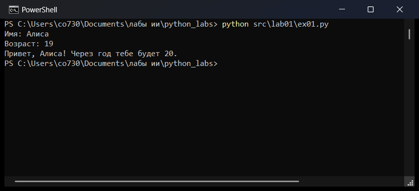
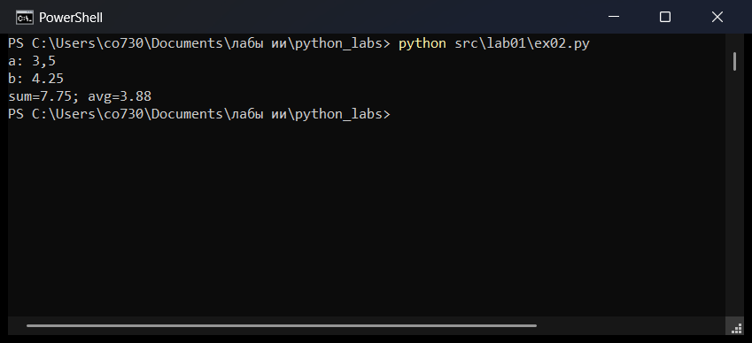
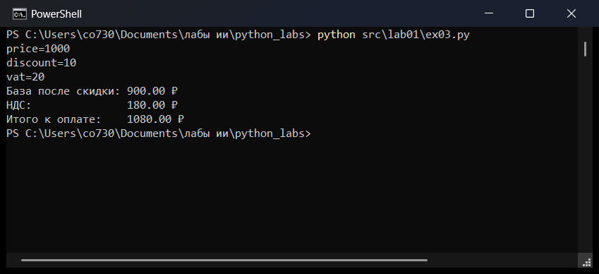
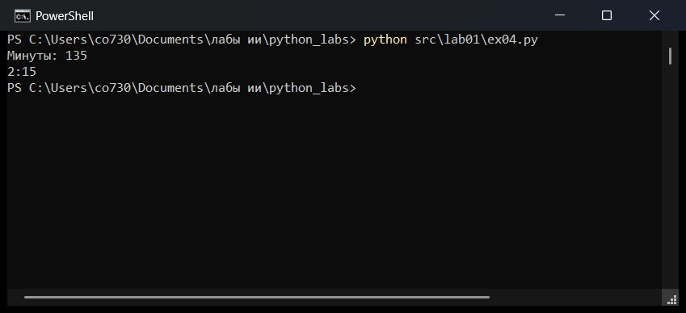
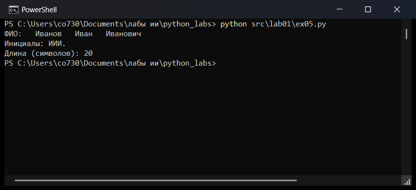
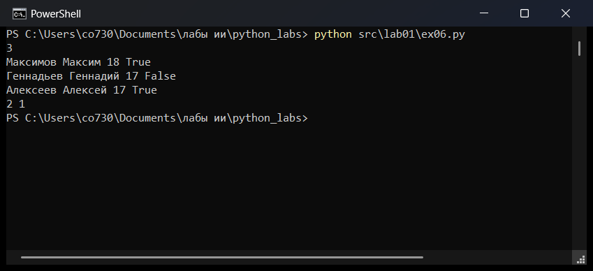
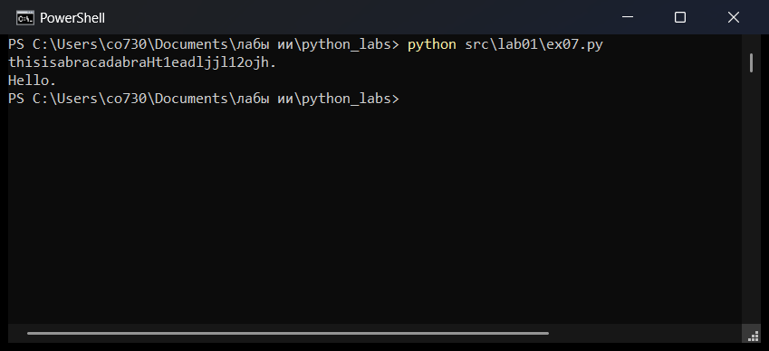

# python_labs

Лабораторные работы по программированию на Python.

## Структура

```
python_labs/
├─ README.md
├─ src/       # скрипты по заданиям (src/lab01, src/lab02, ...)
└─ images/    # скриншоты работы программ (images/lab01, ...)
```

## Запуск

```powershell
py -m venv .venv
.venv\Scripts\Activate.ps1
python src/lab01/ex01.py
```

---

# ЛР1 — Ввод/вывод и форматирование

### Задание 1 — Привет и возраст

Файл: [`src/lab01/ex01.py`](src/lab01/ex01.py)

```python
name = input("Имя: ")
age = int(input("Возраст: "))
print(f"Привет, {name}! Через год тебе будет {age + 1}.")
```



*Рис. 1. Задание 1: ввод имени и возраста, вывод приветствия*

---

### Задание 2 — Сумма и среднее

Файл: [`src/lab01/ex02.py`](src/lab01/ex02.py). Числа можно вводить и через точку, и через запятую: запятая заменяется на точку перед `float()`.

```python
a = float(input("a: ").replace(",", "."))
b = float(input("b: ").replace(",", "."))
s = a + b
avg = s / 2
print(f"sum={s:.2f}; avg={avg:.2f}")
```



*Рис. 2. Задание 2: сумма и среднее двух чисел с 2 знаками после точки*

---

### Задание 3 — Чек: скидка и НДС

Файл: [`src/lab01/ex03.py`](src/lab01/ex03.py)

```python
price = float(input("price=").replace(",", "."))
discount = float(input("discount=").replace(",", "."))
vat = float(input("vat=").replace(",", "."))

base = price * (1 - discount / 100)
vat_amount = base * (vat / 100)
total = base + vat_amount

print(f"{'База после скидки:':<19}{base:.2f} ₽")
print(f"{'НДС:':<19}{vat_amount:.2f} ₽")
print(f"{'Итого к оплате:':<19}{total:.2f} ₽")
```



*Рис. 3. Задание 3: расчёт чека (price=1000, discount=10, vat=20)*

---

### Задание 4 — Минуты → ЧЧ:ММ

Файл: [`src/lab01/ex04.py`](src/lab01/ex04.py)

```python
m = int(input("Минуты: "))
hours, minutes = divmod(m, 60)
print(f"{hours}:{minutes:02d}")
```



*Рис. 4. Задание 4: перевод 135 минут в формат 2:15*

---

### Задание 5 — Инициалы и длина строки

Файл: [`src/lab01/ex05.py`](src/lab01/ex05.py). `split()` без аргументов убирает все лишние пробелы, а `" ".join(...)` собирает строку обратно с одиночными пробелами.

```python
fio = input("ФИО: ")
parts = fio.split()
initials = "".join(p[0].upper() for p in parts)
clean = " ".join(parts)
print(f"Инициалы: {initials}.")
print(f"Длина (символов): {len(clean)}")
```



*Рис. 5. Задание 5: инициалы и длина ФИО без лишних пробелов*

---

### Задание 6* — Подсчёт участников

Файл: [`src/lab01/ex06.py`](src/lab01/ex06.py)

```python
n = int(input())
full_time = 0
part_time = 0
for _ in range(n):
    surname, name, age, is_full_time = input().split()
    if is_full_time == "True":
        full_time += 1
    else:
        part_time += 1
print(full_time, part_time)
```



*Рис. 6. Задание 6\*: количество участников очного и заочного формата*

---

### Задание 7* — Расшифровка строки

Файл: [`src/lab01/ex07.py`](src/lab01/ex07.py)

Алгоритм:
1. Находим первую заглавную букву: это первый символ ответа.
2. Находим первую цифру: следующий за ней символ — второй символ ответа.
3. Расстояние между ними — шаг.
4. Берём символы с этим шагом, пока не встретим точку `.` (включительно).

```python
s = input()

# 1. первая заглавная буква — первый символ оригинала
start = next(i for i, ch in enumerate(s) if ch.isupper())
# 3. второй символ стоит сразу после первой цифры
second = next(i for i, ch in enumerate(s) if ch.isdigit()) + 1
# 2. символы расположены с фиксированным шагом
step = second - start

result = ""
for ch in s[start::step]:
    result += ch
    # 4. последний символ оригинала — точка
    if ch == ".":
        break
print(result)
```



*Рис. 7. Задание 7\*: восстановление строки `Hello.`*
